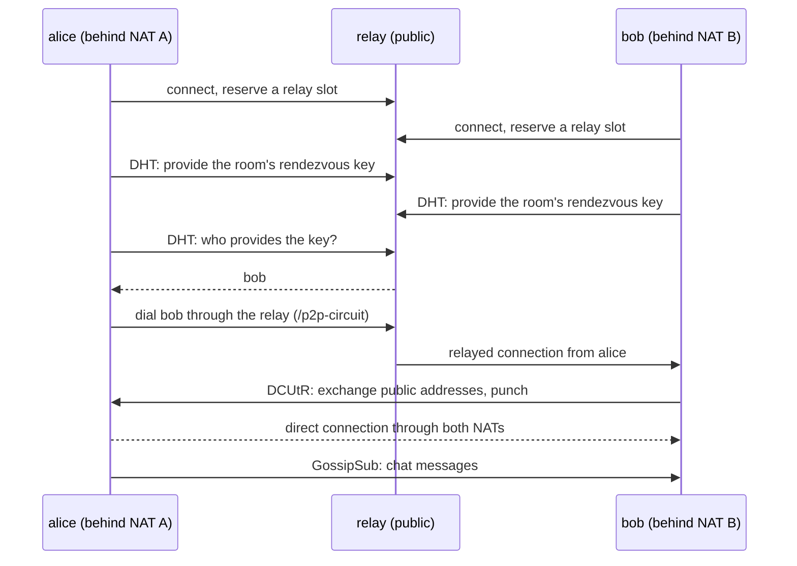

# Internet chat: relay, DHT and GossipSub

This demo is a chat between Dart peers on different home networks. The peers
are behind NAT routers, so they cannot accept connections from the internet.
They still find each other, chat, and in most cases end up with a direct
connection. They use one public node: a relay that is also the DHT bootstrap
node.

It uses the parts of the dart_libp2p stack that a real peer-to-peer app needs
over the internet:

| Part | Package | What it does here |
|---|---|---|
| UDX and TCP transports | `dart_libp2p`, `dart_udx` | UDX (over UDP) for hole punching, TCP for networks that block UDP |
| Circuit Relay v2 | `dart_libp2p` | Lets a peer behind NAT be reached through the relay |
| AutoRelay | `dart_libp2p` | Reserves a slot on the relay, and keeps it |
| DCUtR | `dart_libp2p` | Upgrades a relayed connection to a direct one by hole punching |
| Kademlia DHT | `dart_libp2p_kad_dht` | Peers in the same room find each other by a rendezvous key |
| GossipSub | `dart_libp2p_pubsub` | Carries the chat messages, signed by their senders |

The code is in [`internet_chat/`](../internet_chat/). It is one program with
two roles: `relay` for the public node and `peer` for everyone else.

## How it works



1. **The relay** listens on a public address. It runs the Circuit Relay v2
   service, a DHT server, and a GossipSub member of the chat rooms.
2. **A peer** starts by connecting to the relay. Two things follow:
   - AutoRelay reserves a slot on the relay, so that other peers can reach
     this peer at `<relay address>/p2p-circuit/p2p/<peer ID>`.
   - Identify tells the peer which address the relay saw it come from: the
     public side of its NAT. The peer needs that address for hole punching.
3. **Rendezvous.** Each peer provides a key in the DHT that is derived from
   the room name, and looks up the other providers of the same key every 10
   seconds. The relay is the DHT server that holds these provider records.
4. **Connection.** A peer dials each provider it finds through the relay.
   The relayed connection is enough to chat on.
5. **Hole punching.** The peer that receives a relayed connection starts
   DCUtR. The two peers exchange their public addresses over the relayed
   connection and dial each other at the same moment. Each NAT then sees an
   outgoing packet before the incoming one, and lets the other peer in. When
   that works, the peers have a direct connection and the relay no longer
   carries their traffic.
6. **Chat.** Messages go over GossipSub on the topic
   `/internet-chat/1.0.0/room/<room>`. Each message is signed with its
   sender's key, and receivers check the signature. The relay is a member
   of the topic too, so messages still arrive when two peers cannot connect
   to each other.

## Run it on one machine

You need the [Dart SDK](https://dart.dev/get-dart) 3.5 or later.

```sh
git clone https://github.com/stephanfeb/dart-libp2p-demos.git
cd dart-libp2p-demos/internet_chat
dart pub get
```

Start the relay. It prints the addresses that peers use to reach it:

```sh
dart run bin/internet_chat.dart relay
```

```text
Relay running. Peer ID: 12D3KooWBgGRRR9UWqiM5oNs3Te3sKLtkJmTYJfvEHBZCAhnFWqj
Peers can use any of these addresses as --relay:
  /ip4/192.168.50.241/udp/4001/udx/p2p/12D3KooWBgGRRR9UWqiM5oNs3Te3sKLtkJmTYJfvEHBZCAhnFWqj
  /ip4/192.168.50.241/tcp/4001/p2p/12D3KooWBgGRRR9UWqiM5oNs3Te3sKLtkJmTYJfvEHBZCAhnFWqj
```

In two more terminals, start two peers with one of those addresses. Each
peer needs its own key file:

```sh
dart run bin/internet_chat.dart peer --nick alice --key alice.key \
  --relay /ip4/192.168.50.241/udp/4001/udx/p2p/12D3KooW...
dart run bin/internet_chat.dart peer --nick bob --key bob.key \
  --relay /ip4/192.168.50.241/udp/4001/udx/p2p/12D3KooW...
```

Type a line and press Enter to send it. Within a few seconds each peer
prints what happens:

```text
* Reachable through the relay at:
    /ip4/192.168.50.241/udp/4001/udx/p2p/12D3KooWBgGR.../p2p-circuit/p2p/12D3KooWRY4Q...
* Found …mpqzKJ in the DHT
* Direct connection to …mpqzKJ: /ip4/192.168.50.241/udp/53009/udx
<bob> hi alice
```

The peer commands are `/peers` (connections, and whether each is direct or
relayed), `/addrs` (this peer's own addresses) and `/quit`.

## Run it across simulated NATs with Docker

The `docker/` directory has a Compose setup that puts each peer on its own
private network behind its own NAT router. The relay sits on a shared
network that stands in for the internet:

```text
internet  100.70.0.0/16    relay 100.70.3.10, nat-a 100.70.1.10, nat-b 100.70.1.20
home-a    192.168.1.0/24   nat-a 192.168.1.10, alice 192.168.1.100
home-b    192.168.2.0/24   nat-b 192.168.2.10, bob   192.168.2.100
```

alice and bob cannot reach each other's private addresses. The NAT routers
use iptables masquerading, as a home router does.

```sh
cd internet_chat
docker compose -f docker/compose.yml up --build
```

The two peers send a message every 20 seconds. Their log shows the relay
reservation, the DHT lookup, and then a direct connection between the two
NATs' public addresses:

```text
alice-1  | * Found …hiScXj in the DHT
alice-1  | * Direct connection to …hiScXj: /ip4/100.70.1.20/udp/45709/udx
alice-1  | <bob> hello from behind NAT B #1
```

To chat yourself, attach to a peer (Ctrl-P Ctrl-Q detaches):

```sh
docker attach internet-chat-alice-1
```

**When hole punching fails.** A symmetric NAT gives every destination a
different public port, so the port that the relay observed is not the port
that the punch leaves from. Run the setup with symmetric NATs to see it:

```sh
NAT_TYPE=symmetric docker compose -f docker/compose.yml up
```

The peers stay connected through the relay and the chat continues, but the
log never shows a direct connection.

To see the hole punch step by step, turn on its log:

```sh
CHAT_FLAGS='--debug p2p-holepunch' docker compose -f docker/compose.yml up
```

## Run it over the internet

Put the relay on a host with a public IP address, such as a small cloud VM,
and open port 4001 for both UDP and TCP in its firewall.

On many cloud VMs the network interface has a private address and the
provider translates the public one. The relay cannot see its public address
there, so give it with `--announce`:

```sh
dart compile exe bin/internet_chat.dart -o internet_chat
./internet_chat relay --key /var/lib/internet-chat/relay.key \
  --announce /ip4/203.0.113.7/udp/4001/udx \
  --announce /ip4/203.0.113.7/tcp/4001
```

Keep the key file: the peer ID is part of the address that peers dial, and a
new key means a new address. Peers then use the public addresses:

```sh
./internet_chat peer --nick alice --key alice.key \
  --relay /ip4/203.0.113.7/udp/4001/udx/p2p/12D3KooW... \
  --relay /ip4/203.0.113.7/tcp/4001/p2p/12D3KooW...
```

Giving both the UDX and the TCP address lets a peer on a network that blocks
UDP still reach the relay over TCP. Its chat then goes through the relay,
because hole punching needs UDP.

To run the relay as a service, a systemd unit is enough:

```ini
[Unit]
Description=internet_chat relay
After=network-online.target

[Service]
ExecStart=/usr/local/bin/internet_chat relay --key /var/lib/internet-chat/relay.key --announce /ip4/203.0.113.7/udp/4001/udx --announce /ip4/203.0.113.7/tcp/4001
Restart=always
DynamicUser=yes
StateDirectory=internet-chat

[Install]
WantedBy=multi-user.target
```

## The code

All the libp2p setup is in five short files under
[`internet_chat/lib/src/`](../internet_chat/lib/src/).

### The host

[`host.dart`](../internet_chat/lib/src/host.dart) builds the host. The relay
and the peers differ only in a few options:

```dart
Libp2p.transport(UDXTransport(connManager: connManager)),
Libp2p.transport(TCPTransport(resourceManager: NullResourceManager(), connManager: connManager)),
Libp2p.listenAddrs([
  MultiAddr('/ip4/0.0.0.0/udp/$port/udx'),
  MultiAddr('/ip4/0.0.0.0/tcp/$port'),
]),
Libp2p.holePunching(true),
if (relay) ...[
  Libp2p.relay(true),
  Libp2p.forceReachability(Reachability.public),
] else ...[
  Libp2p.autoRelay(true),
  Libp2p.relayServers(relayServers),
  Libp2p.observedAddrActivationThreshold(1),
],
```

- The relay service starts only on a host that knows it is publicly
  reachable. A relay with a public address can say so with
  `forceReachability`, instead of waiting for AutoNAT to find out.
- A peer learns its public address from what other peers observe. By
  default an address counts only after four peers report it. A peer that
  knows only the relay has one observer, so the threshold is 1.

### The DHT

[`relay_node.dart`](../internet_chat/lib/src/relay_node.dart) runs the DHT in
server mode. [`peer_node.dart`](../internet_chat/lib/src/peer_node.dart) runs
it in client mode, because a peer behind NAT cannot answer queries, and
bootstraps from the relay:

```dart
final dht = IpfsDHTv2(
  host: host,
  providerStore: MemoryProviderStore(),
  options: DHTOptions(
    mode: DHTMode.client,
    bootstrapPeers: relays.map(MultiAddr.new).toList(),
  ),
);
await dht.start(); // before host.start(), so Identify announces the DHT protocol
await host.start();
await dht.bootstrap();
```

The rendezvous key is a CID of the room name
([`room.dart`](../internet_chat/lib/src/room.dart)). It is a CIDv0, whose bytes
are a plain sha2-256 multihash. go-libp2p's DHT keys provider records by
multihash, so a Go peer that provides the same multihash finds these peers too.

```dart
CID rendezvousKey(String room) => CID.fromData(
      CID.V0,
      'dag-pb',
      Uint8List.fromList(utf8.encode('/internet-chat/1.0.0/rendezvous/$room')),
    );

await dht.provide(rendezvousKey(room), true);
await for (final provider in dht.findProvidersAsync(rendezvousKey(room), 20)) { ... }
```

### Dialing a peer that is behind NAT

A provider record carries the addresses that the provider listens on, which
are private addresses behind a NAT. The peer dials through the relay instead:

```dart
final viaRelays = [
  for (final r in relays) MultiAddr('$r/p2p-circuit/p2p/${peer.toBase58()}'),
];
await host.connect(AddrInfo(peer, viaRelays));
pubsub.announceSubscriptionsTo(peer);
```

Nothing more is needed for the direct connection: the peer that receives
the relayed connection starts DCUtR by itself.

Two peers can find each other in the same lookup round. If both dialed, each
would start DCUtR as the receiver of a relayed connection, and the two hole
punches would collide. So only the peer with the lower peer ID dials.

### GossipSub

```dart
final pubsub = PubSub(host, GossipSubRouter(params: gossipParams));
await pubsub.start();
final subscription = pubsub.subscribe('/internet-chat/1.0.0/room/lobby');
await pubsub.publish('/internet-chat/1.0.0/room/lobby', data);
```

GossipSub does not discover peers. It uses the peers that the host is
connected to. When the peer subscribes, it tells its current connections; for
a connection made later, `announceSubscriptionsTo` does the same. The router
forms its mesh once per heartbeat, so the demo shortens the heartbeat to 5
seconds.

## Limits

- **One relay is a single point of failure.** Peers that already have a
  direct connection keep it, but new peers cannot join while the relay is
  down. Run more than one relay and give each peer all of them with
  `--relay`.
- **Relayed traffic.** Circuit Relay v2 is meant for short connections and
  for coordinating hole punches, so a relay limits each relayed connection.
  dart_libp2p's defaults are 1 hour and 1 MiB; a go-libp2p relay allows 2
  minutes and 128 KiB. When a relayed connection ends, the chat continues:
  the relay is itself a GossipSub member of the room, so messages go from
  each peer to the relay and on to the other peer over their ordinary
  connections to the relay.
- **Symmetric NATs** (common on mobile networks and in some offices) defeat
  hole punching. Peers behind them stay on the relay.
- **The demo trusts its relay.** The relay sees who talks to whom and can
  refuse to forward. It cannot read or forge chat messages: connections are
  encrypted end to end with Noise, and messages are signed.

## Troubleshooting

| Symptom | Cause |
|---|---|
| `Relay ... is unreachable` | The relay address or peer ID is wrong, or a firewall blocks port 4001. Check UDP and TCP. |
| No `Reachable through the relay` line | The peer has no relay reservation. Check the relay's log for the peer's connection. |
| `Found` lines, but only `through the relay` | Hole punching failed: a symmetric NAT on one side, or UDP blocked. Run with `--debug p2p-holepunch`. |
| No `Found` lines | The peers are in different rooms, or use different relays that do not know each other. |

Logs are off by default. `--log INFO` turns them on for every library, and
`--debug <logger>` turns on one logger, such as `p2p-holepunch`,
`RelayFinder`, `CircuitV2Client` or `identify`.
